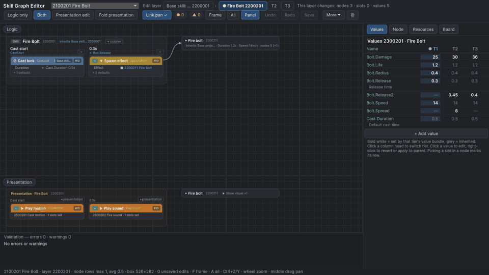

**[한국어](README.md)** · [](https://github.com/Noskang/Noskang_Skill_Graph_Kit/actions/workflows/python-tests.yml) [](https://github.com/Noskang/Noskang_Skill_Graph_Kit/releases) [](LICENSE) 

# SkillGraph Kit

**Build game skills from modules, keep the numbers in Excel, and edit both in a Unity graph editor.**

A tool set made to be usable across action games. Designers build and tune skills in the graph and in Excel; programmers
write each module as one small function. The full documentation is in Korean ([README](README.md), [docs/](docs/)); this
page is a short English overview.



## What it does

SkillGraph Kit splits a game skill into *behaviour* (a graph of event + module nodes) and *numbers* (rows in Excel).

- **Three-layer inheritance** — base → skill → tier, like prefab variants. A child layer adds (`+`) or removes (`−`) nodes
  and overrides single slots, so similar skills are not copied.
- **Graph editor** — a GraphView editor draws the logic graph and the presentation graph on the same time columns, and
  marks where every slot value comes from (value table, fixed, board key, module default).
- **Excel round trip** — the workbooks are the source. A Python backend expands and validates every layer and writes back
  only the cells you edited, after checking for locks and outside changes.

Animation keyframes can drive hit timing (`@node:Swing`). Board keys (named values such as `Combo.Count`, per cast or per
character) let nodes write and read state while a skill runs, so stacking passives and combo counters need no custom code.
Event names, bundle kinds, key layout, layer names and the time grid all come from settings, so the core is not tied to
one genre (a turn-based preset is part of the test suite).

## Getting started (demo)

Needs Unity **6000.3** and, for the editor, Python **3.10+** with **openpyxl 3.1** (running the demo scene needs no Python).

```bash
git clone https://github.com/Noskang/Noskang_Skill_Graph_Kit.git
python -m pip install "openpyxl>=3.1,<4"
```

1. Open the **`DemoProject`** folder in Unity Hub.
2. **Edit › Preferences › SkillGraph Kit**: set *Python* to a `python.exe` that has openpyxl.
3. **Tools › SkillGraph Kit › Skill Graph Editor**: pick a skill in the top list. The `한` / `EN` toolbar button switches the
   editor language.
4. Play `Assets/SkillGraphDemo/Demo.unity` and press **1–9** to cast the demo skills.

## Adding it to your game

What differs per game lives in three places — a settings file, C# module declarations and Python plugins — and the core
is not changed.

1. Add the package to `Packages/manifest.json`:
   `"com.noskang.skillgraphkit": "https://github.com/Noskang/Noskang_Skill_Graph_Kit.git?path=/Packages/com.noskang.skillgraphkit"`
2. Declare events, bundle kinds and modules in one `ModuleSetProvider` subclass, then **Tools › SkillGraph Kit › Export
   Module Dictionary**.
3. Put a `skillgraph.json` in the project folder (`{}` = all defaults).
4. Start the workbooks from the demo ones, then **More › Build skill data** to export logic / presentation JSON.
5. At runtime: `SkillData.Load(...)`, and an `IModuleHandler` that runs each module in your game.
6. Game-specific checks go in a Python plugin (`plugins.validate`).

A complete worked example with a made-up 2D brawler (settings, declarations, workbook rows, handler and a plugin) is in
[docs/integration-guide.md](docs/integration-guide.md) (Korean, code in English).

## Tests and license

105 automated tests: 66 Python tests (run by GitHub Actions on Windows with Python 3.12 on every push to main) and 39 Unity
EditMode tests (run locally; they need a Unity license). Checked on Windows only. [MIT](LICENSE). Acknowledgements are in
the [Korean README](README.md#감사의-말).
