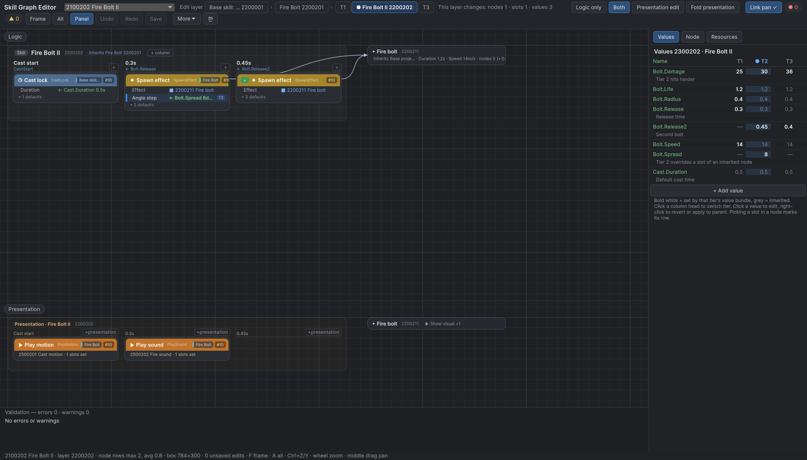
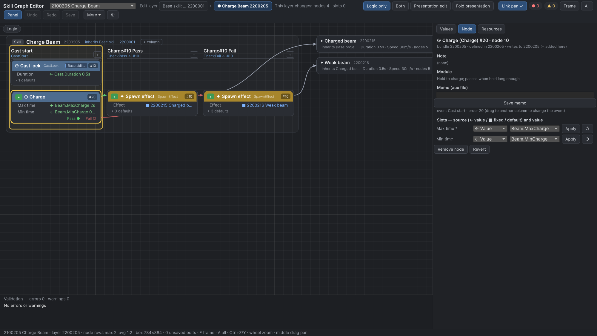
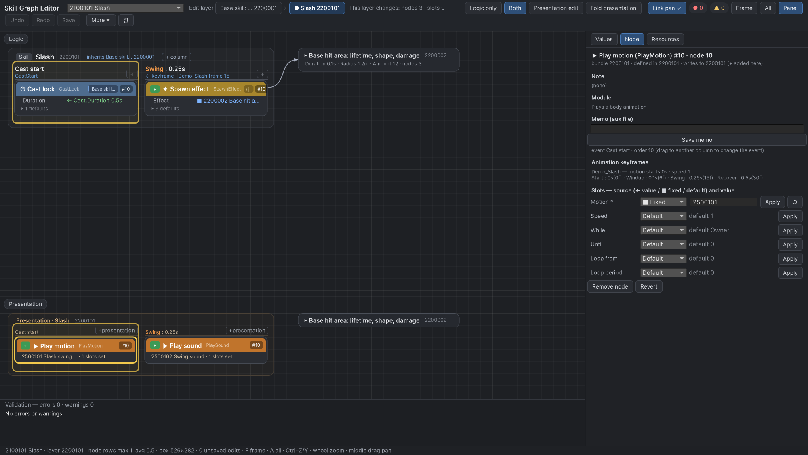
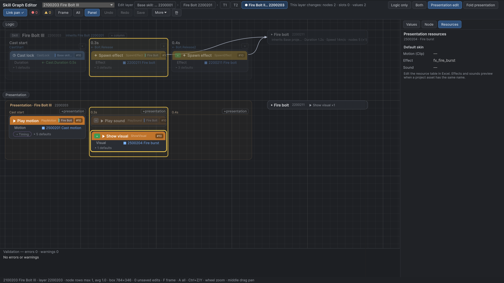
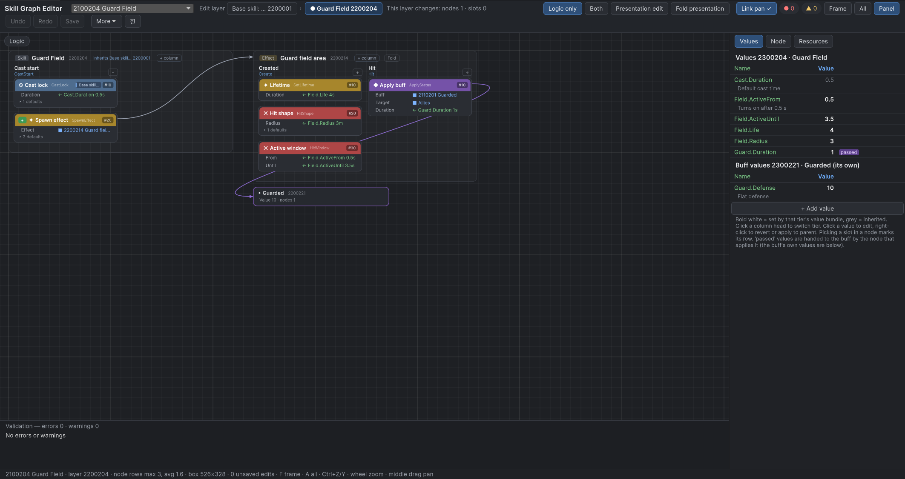
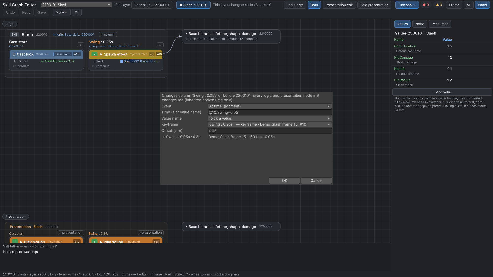
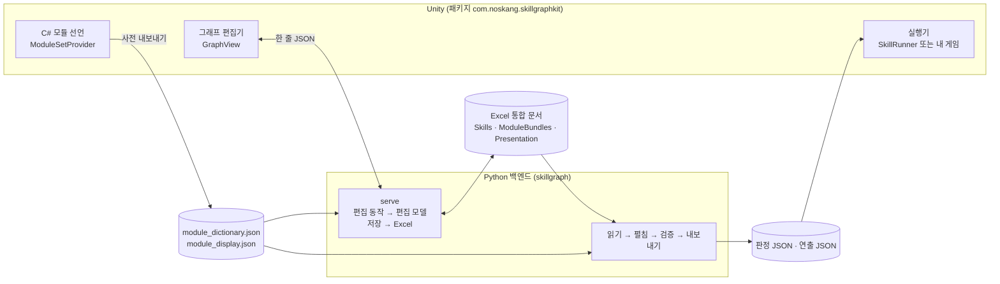

# SkillGraph Kit

**모듈을 조합해 기술을 만들고, 수치는 Excel에 두고, 그래프 편집기로 고치는 Unity 도구 모음**



> **English summary** — SkillGraph Kit splits a game skill into *behaviour* (a graph of event + module nodes) and *numbers*
> (rows in Excel). Skills inherit from base layers like prefab variants, a Python backend expands and validates every layer
> and round-trips the workbooks without touching cells you did not edit, and a GraphView editor in Unity draws the logic
> graph and the presentation graph on the same time columns. Animation keyframes can drive hit timing (`@node:Swing`).
> Event names, bundle kinds, key layout, layer names and the time grid all come from settings, so the core is not tied to
> one genre (a turn-based preset is part of the test suite). Includes a demo project, 69 automated tests and a capture
> command that produced the screenshots below. Unity 6000.3, Python 3.10+ with openpyxl, MIT.

개인 게임 프로젝트에서 기술 데이터를 옮기며 만든 도구를, 다른 프로젝트에서도 쓸 수 있게 장르에 묶이지 않는 형태로 다시 정리한 저장소입니다.

---

## 푼 문제

기술 하나에 동작 코드와 수치가 섞여 있으면 기획자가 혼자 고칠 수 없습니다. 수치 하나를 바꾸려 해도 프로그래머를 거쳐야 하고, 비슷한 기술이 늘면 같은 코드가 복사됩니다. 단계(1단계·2단계·3단계)마다 조금씩 다른 기술은 더 그렇습니다.

## 해결 방식

| 나눈 것 | 담는 곳 | 고치는 사람 |
|---|---|---|
| **동작** — 언제(이벤트) 무엇을(모듈) 하는가 | 모듈 묶음 표(노드·값 연결) + 그래프 편집기 | 기획자 |
| **수치** — 피해·시각·사거리 | 수치 표(객체.이름 = 값) | 기획자 |
| **모듈의 실제 동작** — 피해를 어떻게 주는가 | C# 코드(모듈 하나 = 작은 함수 하나) | 프로그래머 |

- **노드 = 이벤트 + 모듈.** "시전 시작에 시전 잠금", "0.3초에 효과 생성", "명중하면 피해". 판정 줄과 연출 줄을 따로 두고 같은 시간 열에 나란히 놓습니다.
- **3층 상속(Prefab Variant처럼).** 공통 바탕 → 기술 → 단계. 자식 층은 노드를 더하고(`+`), 빼고(`−`), 칸 하나만 덮어씁니다. 수치 묶음도 같은 방식으로 이어받습니다.
- **칸마다 출처 하나.** 수치 참조(`← Bolt.Damage`) · 그래프에 고정(`■ Box`) · 모듈 기본값. 검증이 모든 층을 펼쳐 빠진 값, 맞지 않는 이벤트, 순서가 같은 노드 같은 실수를 잡습니다.
- **Excel이 원본.** 편집기는 Excel을 읽어 고친 칸만 다시 씁니다. 저장 전에 잠금·외부 변경을 검사하고, 직전 사본 1개를 남기고, 저장 뒤 다시 읽어 같은지 대조합니다.
- **애니메이션 키프레임이 시각이 됨.** 시각 조건에 `@10:Swing`을 적으면 그 모션의 `Swing` 키프레임이 판정 시각(0.25초)으로 환산됩니다. 아트가 자세를 옮기면 타격 시각도 따라갑니다.
- **장르 중립 코어.** 이벤트 이름, 묶음 종류, Key 자릿수, 층 이름·깊이, 시간 단위·격자는 모두 설정입니다. 실시간 액션 데모와 턴제 최소 예시가 같은 코어로 시험됩니다.

## 대표 화면

| | |
|---|---|
|  |  |
| **통과/실패 갈래** — 충전 노드의 출구 열이 계단처럼 붙고, 갈래마다 다른 효과를 만듭니다 | **키프레임 열** — `Swing : 0.25s`, 노드 탭에 애니메이션 키프레임 목록 |
|  |  |
| **연출 편집 보기** — 판정은 흐리게, 3단계가 뺀 소리 노드는 반투명 | **효과·버프 상자** — 생성 선을 따라 효과 객체와 버프 묶음을 펼쳐 봅니다 |
|  |  |
| **열 바꾸기** — 키프레임 + 오프셋(+0.05초 → 0.3초) | **편집기 글자 영/한 전환** |

화면은 모두 `DemoProject/Capture/screens.json`을 캡처 명령으로 찍은 것입니다(손으로 자르거나 고치지 않음).

## 구조



- **코드가 기준**: 모듈 사전은 C# 선언에서 내보냅니다. 같은 사전을 Python 도구도 만들 수 있고, 두 결과가 바이트까지 같은지 시험합니다.
- **화면과 모델의 경계는 JSON**: 편집기는 "처음 읽은 Excel + 편집 동작 목록"을 백엔드에 보내고 펼친 모델을 받습니다. 되돌리기/다시하기는 동작 목록을 줄이고 늘리는 일이라 편집기 안에서 끝납니다.
- **판정과 연출은 다른 파일**: 서버·판정은 판정 JSON만, 화면은 연출 JSON을 함께 읽습니다.

자세한 설명은 [docs/architecture.md](docs/architecture.md), 파일 형식은 [docs/data-contract.md](docs/data-contract.md), 편집기 조작은 [docs/editor-guide.md](docs/editor-guide.md)에 있습니다.

## 빠른 시작 (데모)

**필요한 것**
- Unity **6000.3** (6000.3.24f1에서 확인). 패키지 시험 틀(test-framework)이 Unity에 들어 있어 외부망이 필요 없습니다.
- Python **3.10 이상**과 **openpyxl 3.1**. 그래프 편집기와 Excel 저장에 필요합니다(데모 장면 실행에는 필요 없음).

```bash
git clone https://github.com/Noskang/Noskang_Skill_Graph_Kit.git
python -m pip install "openpyxl>=3.1,<4"
```

1. Unity Hub에서 **`DemoProject`** 폴더를 프로젝트로 엽니다.
2. **Edit › Preferences › SkillGraph Kit** 에서 *Python* 칸에 openpyxl이 있는 `python.exe`를 고릅니다. *Settings* 칸은 비워 두면 `DemoProject/skillgraph.json`을 씁니다.
3. **Tools › SkillGraph Kit › Skill Graph Editor** 를 엽니다. 위쪽 목록에서 기술을 고르고, 노드의 칸을 누르면 오른쪽 수치 표의 그 행이 강조됩니다. 툴바 오른쪽 `한` / `EN` 단추로 글자 언어를 바꿉니다(기본 영어).
4. 수치 칸을 눌러 값을 바꾸고 **Save(저장)** 하면 변경 목록을 보여 준 뒤 `DemoProject/SkillData/*.xlsx`의 그 칸만 고칩니다.

**데모 장면**: `Assets/SkillGraphDemo/Demo.unity`를 열고 Play(장면을 다시 만들려면 **Tools › SkillGraph Kit › Demo › Rebuild Demo Scene**). 숫자 **1~9**로 기술을 씁니다(9번 Charge Beam은 누르고 있다가 뗌). 동작과 시각은 모두 `Assets/StreamingAssets/SkillData/`의 판정 JSON에서 옵니다. Excel을 고쳤다면 **Tools › SkillGraph Kit › Demo › Export Skill Data to StreamingAssets** 로 다시 내보냅니다.

**시험**
```bash
cd Packages/com.noskang.skillgraphkit/Tools~/python
python -X utf8 -m unittest discover -s tests -t tests        # Python 50개
```
Unity: **Window › General › Test Runner › EditMode › Run All** (19개). batchmode는 `Unity -batchmode -projectPath DemoProject -runTests -testPlatform EditMode`.

## 내 프로젝트에 붙이기

1. **패키지 넣기** — `Packages/manifest.json`의 `dependencies`에
   `"com.noskang.skillgraphkit": "https://github.com/Noskang/Noskang_Skill_Graph_Kit.git?path=/Packages/com.noskang.skillgraphkit"`
   (또는 이 저장소를 받아 `file:` 경로).
2. **모듈 선언** — `ModuleSetProvider`를 상속한 클래스 하나에 이벤트·묶음 종류·모듈을 선언합니다. 예시는 [`DemoModules.cs`](DemoProject/Assets/SkillGraphDemo/Scripts/DemoModules.cs).
3. **설정 파일** — 프로젝트 폴더에 `skillgraph.json`. 내용이 `{}`이면 모두 기본값(통합 문서 폴더 `Data/`)이고, Key 대역·층 이름·시간 격자·폴더를 바꿀 때만 적습니다([설정 목록](docs/data-contract.md#설정-skillgraphjson)).
4. **사전 내보내기** — **Tools › SkillGraph Kit › Export Module Dictionary**.
5. **통합 문서 만들기** — 데모를 본뜨는 것이 가장 빠릅니다. 패키지 관리자의 *Samples › Demo data* 를 받거나, 패키지의 `Tools~/python` 폴더에서 `python -m skillgraph.demo --out <임시 폴더>`를 돌린 뒤, **`Data/*.xlsx` 세 파일만** 내 프로젝트의 통합 문서 폴더로 복사하고 행을 지우고 씁니다(생성기는 설정·사전 파일도 쓰므로 프로젝트 폴더에 바로 돌리지 않습니다). 패키지를 git URL로 받았다면 패키지 폴더는 `Library/PackageCache/com.noskang.skillgraphkit@…/` 아래입니다.
6. **실행** — **Tools › SkillGraph Kit › Skill Graph Editor › More(더 보기) › Build skill data** 로 판정·연출 JSON을 내보내고, `SkillData.Load(판정 바이트, new MyModules().Build(), 연출 JSON의 valueNames)`로 읽은 뒤 `IModuleHandler`에서 모듈마다 게임 동작을 씁니다. 데모의 [`DemoRunner.cs`](DemoProject/Assets/SkillGraphDemo/Scripts/DemoRunner.cs)(`LoadData`)가 가장 작은 예입니다.

게임 고유의 검사·내보내기는 Python 플러그인(`plugins.validate`·`plugins.export`)으로 덧붙입니다. 코어를 고치지 않습니다.

## 저장소 구성

```
Packages/com.noskang.skillgraphkit/   UPM 패키지
  Runtime/                            모듈 선언·표시 정보·JSON·데이터 묶기·데모 실행기
  Editor/                             그래프 편집기·Python 연결·캡처 명령·키프레임 도구·사전 내보내기
  Tests/Editor/                       EditMode 시험(Python 없이 도는 고정 자료 포함)
  Tools~/python/skillgraph/           Python 백엔드(펼침·검증·Excel 왕복·편집 동작·serve)
  Samples~/Demo/                      데모 통합 문서·사전·애니메이션(생성기로 바이트까지 재현)
DemoProject/                          데모 Unity 프로젝트(장면·데모 모듈·시험·캡처 명세)
docs/                                 설계·데이터 계약·편집기 안내·화면
tools/audit_public.py                 공개 감사(금지어 목록은 저장소 밖에 둠)
```

## 한계

- **GraphView는 Unity의 실험 API**(`UnityEditor.Experimental.GraphView`)입니다. 사용하는 곳을 `SkillGraphCanvas.cs` 한 파일에 모아 두었지만, Unity 버전이 바뀌면 고쳐야 할 수 있습니다.
- **캡처 명령은 편집기 내부 API**(`GUIView.GrabPixels`, 반사로 호출)를 씁니다. 화면이 있는 편집기에서만 되고 batchmode에서는 안 됩니다. 내부 API를 찾지 못하면 화면 전체를 찍는 방식으로 바꾸지 않고 실패합니다.
- **편집기는 Python이 있어야 합니다.** 편집 동작·검증·Excel 쓰기를 한곳(Python)에 두어 Unity 밖 도구와 같은 규칙을 쓰기 위해서입니다. 실행(판정 JSON 읽기)에는 Python이 필요 없습니다.
- **`SkillRunner`는 데모용**입니다. 한 사람, 프레임 단위, 결정성·네트워크 없음. 실제 게임은 같은 데이터를 자기 실행기로 읽습니다.
- **Excel 수식은 받지 않습니다**(값만). 셀 서식은 고친 행 위의 행을 따라 복사합니다.
- Windows에서만 확인했습니다.

## 라이선스

[MIT](LICENSE)

## 감사의 말

노드 구성의 일반 패턴(칸을 적게 보이기, 이름 있는 입력 단계, 조건 → 대상 → 실행 갈래, 기획 문장 그룹 제목, 계열 색, 시간 순 연출)은 LUIZ의 DataGraph를 참고했습니다.
